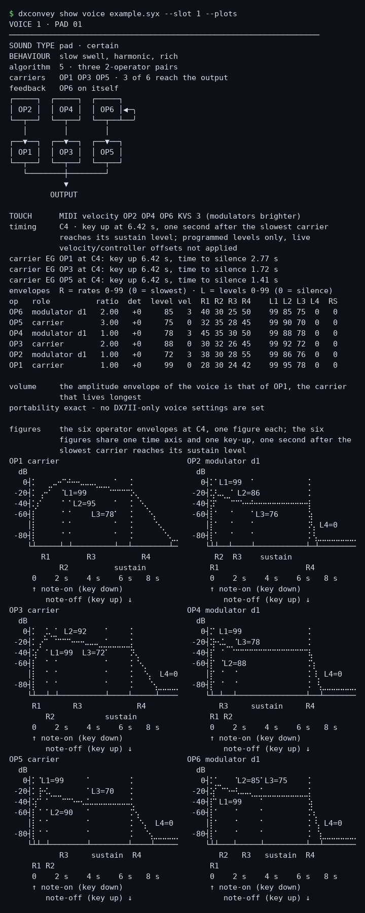
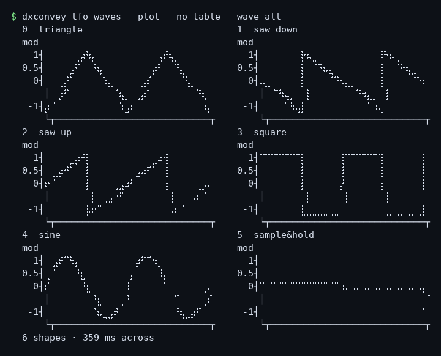
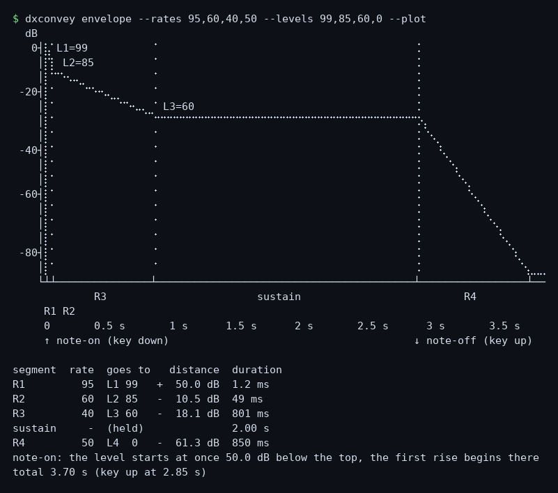

# dxconvey

**Read DX7II SysEx, convert voices for the DX7, and report what the conversion cannot carry.**

> **Placeholder — source code planned by December 2026, possibly as early as November.**
> This repository does not contain the tool source code yet. It describes the
> project and its intended scope; the code, tests and documentation will be added
> when the first public release is ready.

## What the project is

`dxconvey` is a command-line tool for working with Yamaha DX7II and DX7 voice
files. Its first release is intended to read and describe DX7II SysEx data,
convert DX7II voices into DX7 voices, and report which settings are changed or
cannot be carried over. The conversion is a translation, not a promise that the
result will sound identical on both instruments.

The DX7 voice is the common point between the two instruments. The project aims
to make the formats and the differences understandable, rather than hiding them
behind a file conversion.

## Command-line verbs

The CLI is organized around these verbs:

- `show` — inspect a dump;
- `algorithm`, `tuning`, `envelope`, `scaling` and `lfo` — explore instrument
  references and behavior;
- `convert` — create DX7 voices and report conversion losses;
- `help` and `docs` — the help of the command line, and the documents generated
  from it.

A verb says what you want; a **kind** — a word, never a flag — says which answer,
and the options come after it, because an option never changes the subject:

```bash
dxconvey show layout FILE.syx             # the file, one box per SysEx message
dxconvey show voice FILE.syx --slot 2     # one voice, in full
dxconvey convert banks FILE.syx -o OUT    # the conversion, and its register
```

The verb alone gives the shortest useful answer, and two shortcuts exist because
they are the questions asked most: `dxconvey FILE.syx` is `show summary FILE.syx`,
and `dxconvey convert FILE.syx` writes the DX7 banks in a folder beside the dump.

`converse`, a natural-language interface to instrument data, is a later goal; it
is **not** part of the current CLI or the first release.

## What it prints

Every run below is real, and every figure is drawn by the tool. The code is not in this
repository yet — it lands with the conversion — but the numbers are not a mock-up: they
come from `examples/example.syx`, a synthetic DX7II All-Data of 64 voices and 32
performances, with names that belong to nobody. That dump is in the repository, and so is
the script that writes it, so every text capture here can be run again.

The tool draws its curves with the Braille patterns, two dots across and four down in one
cell, which join into a continuous line in a terminal. A page cannot be told which font to
use — GitHub strips the stylesheets, and the font a code block gets on Windows, Consolas,
has no Braille at all — so the three runs that draw are here as pictures of the terminal:
the same characters, the same colours, rendered once and shipped. The text of each run is
in `examples/images/`, and the command under each picture prints it again.

### The dump, at a glance

One line per question: what the file is, what it holds, and what a DX7
would lose.

```console
$ dxconvey show summary example.syx
example.syx  --  12,128 bytes
  DX7II All-Data dump
  contents: 64 voices (2 banks), each a DX7 voice plus its DX7II supplement, 1 performance bank (32)
  not in this dump: micro tuning, fractional key scaling, system set-up

  performances    32 programmed  (11 dual, 10 single, 11 split)
  voices          64 distinct  out of 64 slots: 64 programmed, 0 factory INIT, 0 duplicate content
  used            54 voices  are referenced by the performances (10 programmed voices are not)
  DX7II only      48 of 64 voice slots carry additional parameters: on a DX7 they lose something
```

### The dump, as it is laid out

Every SysEx message of the file is a box: the block's own name, its size, and the
offset where it starts.

```console
$ dxconvey show layout example.syx
  example.syx  ·  12,128 bytes  ·  DX7II All-Data dump

  ┌──────────┬─────────┬──────────┬──────────┬─────────┬──────────┬─────────┐
  │ DATA-CHG │ AMEM    │ VMEM     │ DATA-CHG │ AMEM    │ VMEM     │ PMEM    │
  │ 7 B      │ 1,128 B │ 4,104 B  │ 7 B      │ 1,128 B │ 4,104 B  │ 1,650 B │
  │ 19 4D 00 │ 32x35 B │ 32x128 B │ 19 4D 01 │ 32x35 B │ 32x128 B │ 32x51 B │
  └──────────┴─────────┴──────────┴──────────┴─────────┴──────────┴─────────┘
   @0         @7        @1,135     @5,239     @5,246    @6,374     @10,478
  (AMEM and VMEM of a half hold the same 32 voice slots: the DX7 half and its DX7II supplement)
```

### A voice, in full

One voice is six operators. The sheet says what kind of sound it is and how it
behaves, gives the routing, what a DX7 keeps, the timing of the key-up, the four
rates and four levels of every operator, and then — with `--plots` — the six
envelopes, one figure each, on one time axis and one key-up:



### The performances

A performance is a pointer: two voices, a key mode, a split point, a tuning. One line
each, and the first line counts what the bank holds.

```console
$ dxconvey show performance example.syx
32 performances  ·  11 dual, 10 single, 11 split
1    PAIR 01                  dual    A   1 PAD 01       alg  5  B   2 BELL 02      alg  1  detune 3
2    SPLIT 02                 split   A   3 ORGAN 03     alg 32  B   4 BRASS 04     alg 22  split C4
3    SINGLE 03                single  A   5 PAD 05       alg  5  --
4    PAIR 04                  dual    A   7 ORGAN 07     alg 32  B   8 BRASS 08     alg 22  detune 3
5    SPLIT 05                 split   A   9 PAD 09       alg  5  B  10 BELL 10      alg  1  split C4
6    SINGLE 06                single  A  11 ORGAN 11     alg 32  --
7    PAIR 07                  dual    A  13 PAD 13       alg  5  B  14 BELL 14      alg  1  detune 3
8    SPLIT 08                 split   A  15 ORGAN 15     alg 32  B  16 BRASS 16     alg 22  split C4
9    SINGLE 09                single  A  17 PAD 17       alg  5  --
10   PAIR 10                  dual    A  19 ORGAN 19     alg 32  B  20 BRASS 20     alg 22  detune 3
11   SPLIT 11                 split   A  21 PAD 21       alg  5  B  22 BELL 22      alg  1  split C4
12   SINGLE 12                single  A  23 ORGAN 23     alg 32  --
13   PAIR 13                  dual    A  25 PAD 25       alg  5  B  26 BELL 26      alg  1  detune 3
14   SPLIT 14                 split   A  27 ORGAN 27     alg 32  B  28 BRASS 28     alg 22  split C4
15   SINGLE 15                single  A  29 PAD 29       alg  5  --
16   PAIR 16                  dual    A  31 ORGAN 31     alg 32  B  32 BRASS 32     alg 22  detune 3
17   SPLIT 17                 split   A  33 PAD 33       alg  5  B  34 BELL 34      alg  1  split C4
18   SINGLE 18                single  A  35 ORGAN 35     alg 32  --
19   PAIR 19                  dual    A  37 PAD 37       alg  5  B  38 BELL 38      alg  1  detune 3
20   SPLIT 20                 split   A  39 ORGAN 39     alg 32  B  40 BRASS 40     alg 22  split C4
21   SINGLE 21                single  A  41 PAD 41       alg  5  --
22   PAIR 22                  dual    A  43 ORGAN 43     alg 32  B  44 BRASS 44     alg 22  detune 3
23   SPLIT 23                 split   A  45 PAD 45       alg  5  B  46 BELL 46      alg  1  split C4
24   SINGLE 24                single  A  47 ORGAN 47     alg 32  --
25   PAIR 25                  dual    A  49 PAD 49       alg  5  B  50 BELL 50      alg  1  detune 3
26   SPLIT 26                 split   A  51 ORGAN 51     alg 32  B  52 BRASS 52     alg 22  split C4
27   SINGLE 27                single  A  53 PAD 53       alg  5  --
28   PAIR 28                  dual    A  55 ORGAN 55     alg 32  B  56 BRASS 56     alg 22  detune 3
29   SPLIT 29                 split   A  57 PAD 57       alg  5  B  58 BELL 58      alg  1  split C4
30   SINGLE 30                single  A  59 ORGAN 59     alg 32  --
31   PAIR 31                  dual    A  61 PAD 61       alg  5  B  62 BELL 62      alg  1  detune 3
32   SPLIT 32                 split   A  63 ORGAN 63     alg 32  B  64 BRASS 64     alg 22  split C4
```

### A performance, drawn

`--sheet` stops pointing and draws: which voice plays which keys, the sound of each
in words, the panning, the polyphony, the tuning, the switches — and the algorithm of
each voice as a block diagram. This one is a split, so the keyboard is drawn too.

```console
$ dxconvey show performance example.syx --slot 2 --sheet
PERFORMANCE 2 · SPLIT 02
LAYOUT     split at C4 · Voice A below · Voice B from C4 up
SOUND A    organ · certain
SOUND B    brass · certain
BEHAVIOUR  A: held note, short tail, harmonic, dense, no velocity
           B: held note, harmonic, dark, two layers, closing
voice A     3 ORGAN 03             algorithm 32  OP6 on itself
voice B     4 BRASS 04             algorithm 22  OP6 on itself
MIDI response B velocity OP6 KVS 5 (modulators brighter)
MIDI response B mod wheel: EG bias 64
timing     each voice's key comes up one second after its slowest carrier
           reaches its sustain level; programmed levels only, live
           velocity/controller offsets not applied
timing A   OP1 at C3: key up 1.00 s, time to silence 45 ms
timing A   OP2 at C3: key up 1.00 s, time to silence 40 ms
timing A   OP3 at C3: key up 1.00 s, time to silence 37 ms
timing A   OP4 at C3: key up 1.00 s, time to silence 34 ms
timing A   OP5 at C3: key up 1.00 s, time to silence 31 ms
timing A   OP6 at C3: key up 1.00 s, time to silence 28 ms
timing B   OP1 at C5: key up 4.62 s, silent at key up
timing B   OP3 at C5: key up 4.62 s, time to silence 344 ms
timing B   OP4 at C5: key up 4.62 s, silent at key up
timing B   OP5 at C5: key up 4.62 s, time to silence 515 ms
settings   balance +6 · split C4 · shift +0/+0
stored     inactive here: dual detune 3
volume     total 0
sliders    neither slider is assigned
switches   EG forced damping off · sustain foot switch none · foot switch
           sustain none · soft pedal range 0
polyphony  16 notes · 8 + 8, at most 8 per side · 2 + 2 in unison poly
pan        mix · voices combined, moves the mix · control off
tuning     equal temperament preset 1 (the DX7II default)
unison     A 0 · B 3 (unison detune depth, needs a unison key mode)
keys       61 keys, C2 to C7, one column per semitone
           C2          C3          C4          C5          C6         C7
           ████████████████████████▒▒▒▒▒▒▒▒▒▒▒▒▒▒▒▒▒▒▒▒▒▒▒▒▒▒▒▒▒▒▒▒▒▒▒▒▒
                                   ▲ split at C4

pan EG     flat: levels 0/0/0/0, off centre (nothing moves)

algorithms A six carriers, no modulation
           B one modulator shared by three carriers

           A · ORGAN 03 · algorithm 32
           ┌─────┐  ┌─────┐  ┌─────┐  ┌─────┐  ┌─────┐  ┌─────┐
           │ OP1 │  │ OP2 │  │ OP3 │  │ OP4 │  │ OP5 │  │ OP6 │◀─╮
           └──┬──┘  └──┬──┘  └──┬──┘  └──┬──┘  └──┬──┘  └──┬──┴──╯
              └────────┴────────┴───┬────┴────────┴────────┘
                                    ▼
                                 OUTPUT

           B · BRASS 04 · algorithm 22
           ┌─────┐           ┌─────┐
           │ OP2 │           │ OP6 │◀─╮
           └──┬──┘           └──┬──┴──╯
              │        ┌────────┼───────────┐
           ┌──▼──┐  ┌──▼──┐  ┌──▼──┐     ┌──▼──┐
           │ OP1 │  │ OP3 │  │ OP4 │     │ OP5 │
           └──┬──┘  └──┬──┘  └──┬──┘     └──┬──┘
              └────────┴─────┬──┴───────────┘
                             ▼
                          OUTPUT
```

### A performance, read

`--describe` says what it sounds like instead of drawing it: the tag of each voice
and how sure it is, one phrase of behaviour, and the bytes behind every axis of that
answer — the envelope, the spectrum, the density, the timbre path, the feedback, the
touch — with what the file cannot say.

```console
$ dxconvey show performance example.syx --slot 1 --describe
PERFORMANCE 1 · PAIR 01

layout     two voices on every key: PAD 01 and BELL 02, 3 units apart in
           pitch so they beat
voice A    pad · certain
           slow swell, harmonic, rich
voice B    bell · plausible
           instant hit, short tail, harmonic, very bright, two layers
why A      the envelope: attack slow (carrier R1 28 of 99), body swell, a
           slow attack that settles into the level (L3 78 of 99), release
           medium (R4 42, L4 0).
           the spectrum: carriers at 3.00, 2.00, 1.00 times the key. The
           highest modulator reaches 2.00 times the key, so balanced.
           the density: rich, 3 carriers (OP5, OP3, OP1) and 3 modulators.
           the timbre path: static, the modulators ending at L3 75 against
           the carriers' 70.
           the feedback: strong (4 of 7), the layering layered.
           the touch: velocity.
why B      the envelope: attack instant (carrier R1 99 of 99), body one_shot
           (L3 0 of 99), release short (R4 62, L4 0).
           the spectrum: carriers at 1.00 times the key. The highest
           modulator reaches 14.00 times the key, so very bright.
           the density: pair, 2 carriers (OP3, OP1) and 4 modulators.
           the timbre path: static, the modulators ending at L3 50 against
           the carriers' 0.
           the feedback: strong (6 of 7), the layering single.
           the touch: nothing follows the velocity or a controller.
note       what this cannot say: what a controller's EG bias is worth in
           level steps (not measured), how bright it is in dB (no
           level-to-dB curve), or how it really sounds (no recording was
           heard).  Brightness and density are proxies of the parameters,
           not measurements.
```

### The conversion, and its bill

Two banks land next to the dump, each with the register that names, voice by voice,
what a DX7 keeps and what it does not.

```console
$ dxconvey convert example.syx -o out/
CONVERT  example.syx → out
  2 banks · 64 voices · 16 exact, 32 close, 16 lossy
  pitch EG proportional · 50, 25, 6.25, 3.125

  example_1-32.syx   32 voices · slots 1-32 · the register: example_1-32.txt
  example_33-64.syx  32 voices · slots 33-64 · the register: example_33-64.txt
```

### A reference sheet, and no file needed

The 32 algorithms are the same on every six-operator machine. `algorithm` draws one,
names its carriers and its feedback, and tells how it sounds and how to program it.

```console
$ dxconvey algorithm 5
  algorithm 5  ·  three 2-operator pairs
    carriers    OP1 OP3 OP5
    modulators  OP2 → OP1 · OP4 → OP3 · OP6 → OP5
    feedback    OP6 on itself
    structure   3 stacks of 2: OP2 → OP1, OP4 → OP3, OP6 → OP5

    ┌─────┐  ┌─────┐  ┌─────┐
    │ OP2 │  │ OP4 │  │ OP6 │◀─╮
    └──┬──┘  └──┬──┘  └──┬──┴──╯
       │        │        │
    ┌──▼──┐  ┌──▼──┐  ┌──▼──┐
    │ OP1 │  │ OP3 │  │ OP5 │
    └──┬──┘  └──┬──┘  └──┬──┘
       └────────┼────────┘
                ▼
             OUTPUT

    how it sounds
      Three independent pairs, each a modulator onto its own carrier. Nothing is shared, so the
      result is close to additive synthesis with three coloured partials: each pair can be tuned to
      its own ratio and given its own envelope, and the feedback on OP6 makes the third pair the
      'sawtooth' one. It is the most used and the most forgiving algorithm of the DX7: almost any
      harmonic recipe can be built here, and one pair can be left as a pure sine for the
      fundamental.

    typical sounds
      · organs and flutes with several registrations
      · tubular bells, glockenspiel, celesta: the factory ORCH-CHIME and TUB BELLS use it
      · electric piano: the factory E.PIANO 1 is this algorithm with the third pair at ratio 14.00
        for the tine and the other two at 1.00
      · two- and three-part additive pads, choirs

    programming it
      Set the pairs to harmonic ratios of the fundamental (1, 2, 3, 4, 6, 8) and shape them with
      their own envelopes; OP2, OP4, OP6 control the brightness of their own pair only. Feedback on
      OP6 turns that pair into a near-sawtooth, which is the fastest route to a rich 'analogue'
      sound on the DX7.

    note
      The DX9 (4 operators) borrowed this one as its algorithm 5.
```

### Six waveforms, one figure

The LFO has six shapes and two depths, and the voice stores three bits to pick the
shape. The figure is the whole set on one grid, with the two depths of each:



### One envelope, timed

Four rates and four levels are all a DX7 envelope is. The model turns them into
seconds; the figure carries the note-on, the key-up and the sustain, and the table
under it gives every segment:



## A conversion with a register of losses

DX7II and DX7 voices do not support exactly the same settings. `dxconvey` is
designed to make those differences visible: the conversion reports what it
remaps and what the DX7 voice format cannot preserve. The goal is to make each
conversion understandable, not to suggest that nothing was lost.

An earlier conversion example is available [as a downloadable package](https://solyaris.altervista.org/dx7iipatches/alienazi.zip).
That package predates the current project name and its internal credit uses an
earlier working name. For instrument and patch information, see the
[DX7 collection page](https://solyaris.altervista.org/dx7.html).

## Project principles

- **Explain the result:** report conversion choices and losses.
- **Trace claims:** base format descriptions on Yamaha documentation and
  inspected data.
- **Read first:** do not rewrite source files; write output only where requested.
- **Keep the tool distinct from sound libraries:** this repository is for the
  software, not a patch collection. The one dump here, `examples/example.syx`,
  is synthetic: `examples/make_example.py` writes it, a test checks the bytes,
  and its voices are the factory initialisation voice with names that belong to
  nobody.

## Status and release

The public repository is currently a placeholder. The source code is planned to
be added by **December 2026**, with a possible release in **November 2026**.
The sample package linked above is an earlier conversion example, not a source
code release.

The public repository is licensed under [MIT](LICENSE). That license applies to
the project software, not to separately published sound files.

## Supporting the work

The tool is MIT-licensed and stays free. If you want to support the work
around it — these pages, the notes on the instrument, the open-source
tools — there is a donate button in the **Sponsor** menu of this repository:

- **[Donate with PayPal](https://www.paypal.com/donate/?hosted_button_id=AEV3EVJEUFM32)**

It is a donation, not a purchase: nothing is unlocked, nothing changes in the
license, and no support is promised in exchange. The minimum is 5 EUR, for a
practical reason — below that the PayPal fee takes most of it. The same button
is on the [dxconvey page](https://solyaris.altervista.org/dxconvey.html) and on
the [DX7 collection page](https://solyaris.altervista.org/mesmerism.html).

Buying the DX7II patch banks is a separate thing: those are sound files sold on
the collection page, not funding for this software.

## Questions and corrections

Questions, corrections and objections belong in
[Discussions](https://github.com/solyarisoftware/dxconvey/discussions), in the
**Q&A** category — there the answer that settled it can be marked, and the next
reader finds it instead of asking again. Issues stay closed until there is code
to run: on a repository with no source, an issue is only a slower Q&A.

There is no contact address here on purpose. A thread in the open is the same
conversation as a private letter, except that it stays readable.

DX7, DX7II and TX802 are Yamaha trademarks. This project is not affiliated with
Yamaha.
