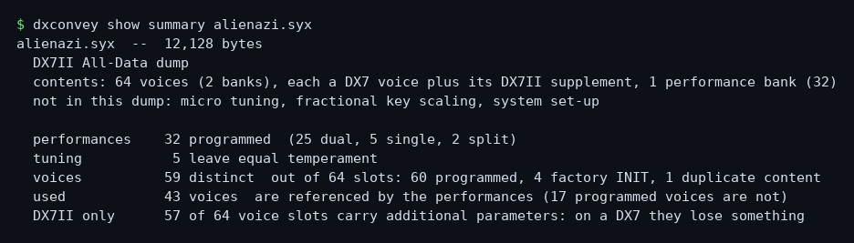
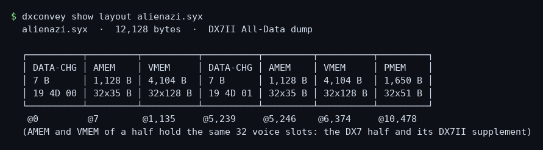
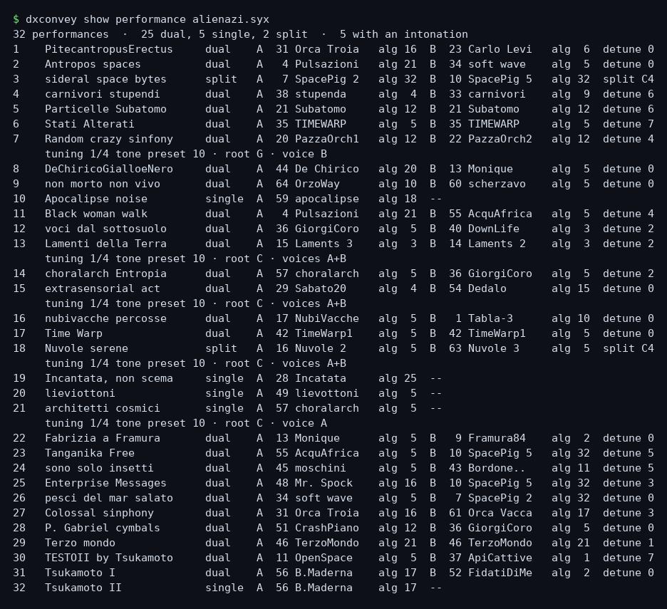
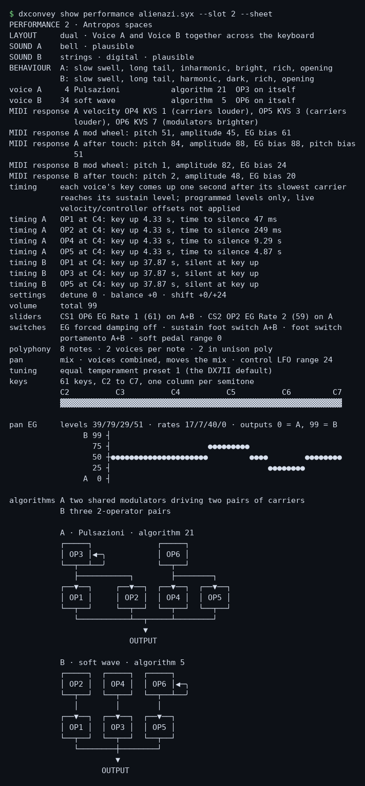
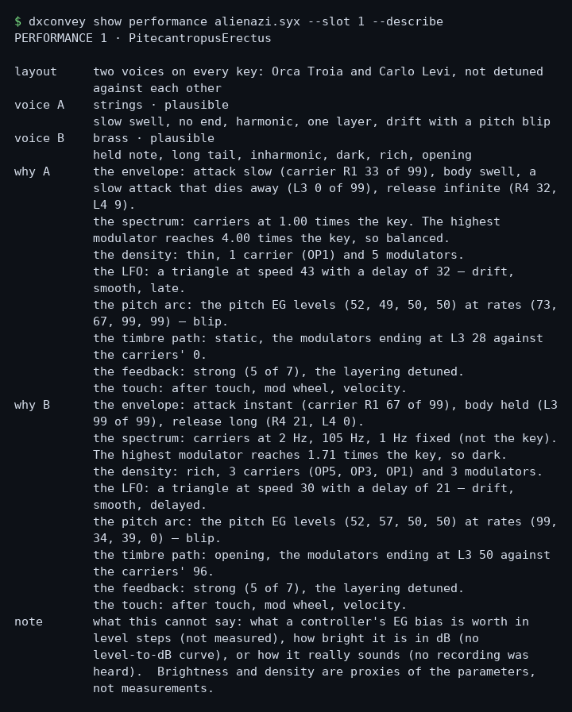
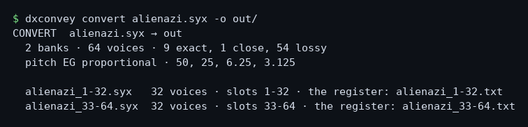
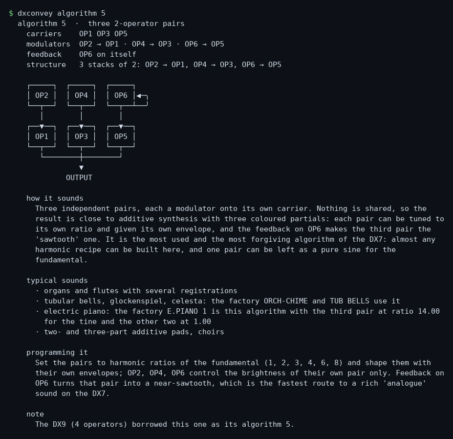

# dxconvey

**Read DX7II SysEx, convert voices for the DX7, and report what the conversion cannot carry.**

> **Placeholder — source code planned by December 2026, possibly as early as November.**
> This repository does not contain the tool source code yet. It describes the
> project and its intended scope; the code, tests and documentation will be added
> when the first public release is ready.

## What the project is

`dxconvey` is a command-line tool for working with Yamaha DX7II and DX7 voice
files. Its first release is intended to read and describe DX7II SysEx data,
convert DX7II voices into DX7 voices, and report which settings are changed or
cannot be carried over. The conversion is a translation, not a promise that the
result will sound identical on both instruments.

The DX7 voice is the common point between the two instruments. The project aims
to make the formats and the differences understandable, rather than hiding them
behind a file conversion.

## Command-line verbs

The CLI is organized around these verbs:

- `show` — inspect a dump;
- `algorithm`, `tuning`, `envelope`, `scaling` and `lfo` — explore instrument
  references and behavior;
- `convert` — create DX7 voices and report conversion losses;
- `help` and `docs` — the help of the command line, and the documents generated
  from it.

A verb says what you want; a **kind** — a word, never a flag — says which answer,
and the options come after it, because an option never changes the subject:

```bash
dxconvey show layout FILE.syx             # the file, one box per SysEx message
dxconvey show voice FILE.syx --slot 2     # one voice, in full
dxconvey convert banks FILE.syx -o OUT    # the conversion, and its register
```

The verb alone gives the shortest useful answer, and two shortcuts exist because
they are the questions asked most: `dxconvey FILE.syx` is `show summary FILE.syx`,
and `dxconvey convert FILE.syx` writes the DX7 banks in a folder beside the dump.

`converse`, a natural-language interface to instrument data, is a later goal; it
is **not** part of the current CLI or the first release.

## What it prints

Every run below is real. The code is not in this repository yet — it lands with the
conversion — but the numbers are not a mock-up: they are `dxconvey` reading one dump,
`alienazi.syx`, the DX7II All-Data of the package published here
([alienazi.zip](https://solyaris.altervista.org/dx7iipatches/alienazi.zip)): 64 voices,
32 performances, and the 60 DX7 voices the conversion makes of them. That file is the
same bank the downloadable package was built from, so the pictures below are the tool's
answer about a file the reader can hold.

Each run is a picture of the terminal, not a code block, for one reason: the tool draws
its curves with the Braille patterns, a page cannot be told which font to use — GitHub
strips the stylesheets, and the font a code block gets on Windows, Consolas, has no
Braille — and a figure retyped in another alphabet is no longer the figure. Every
picture contains the command and its output, as a terminal shows them, and the text is
kept beside it in `examples/images/`.

### The dump, at a glance

One line per question: what the file is, what it holds, and what a DX7
would lose.



### The dump, as it is laid out

Every SysEx message of the file is a box: the block's own name, its size, and the
offset where it starts.



### A voice, in full

One voice is six operators. The sheet says what kind of sound it is and how it
behaves, gives the routing, what a DX7 keeps, the timing of the key-up, the four
rates and four levels of every operator, and then — with `--plots` — the six
envelopes, one figure each, on one time axis and one key-up.  This is the first
voice of `alienazi.syx`: the bank the downloadable package was built from.


### The performances

A performance is a pointer: two voices, a key mode, a split point, a tuning. One line
each, and the first line counts what the bank holds.



### A performance, drawn

`--sheet` stops pointing and draws: which voice plays which keys, the sound of each
in words, the panning, the polyphony, the tuning, the switches — and the algorithm of
each voice as a block diagram.  This one, the second performance of `alienazi.syx`,
is a split, so the keyboard is drawn too.



### A performance, read

`--describe` says what it sounds like instead of drawing it: the tag of each voice
and how sure it is, one phrase of behaviour, and the bytes behind every axis of that
answer — the envelope, the spectrum, the density, the timbre path, the feedback, the
touch — with what the file cannot say.



### The conversion, and its bill

Two banks land next to the dump, each with the register that names, voice by voice,
what a DX7 keeps and what it does not.  This is `alienazi.syx` itself: the same
conversion the published package carries, and the same bill — how many voices come
across untouched, how many are remapped, and how many lose something.



### A reference sheet, and no file needed

The 32 algorithms are the same on every six-operator machine. `algorithm` draws one,
names its carriers and its feedback, and tells how it sounds and how to program it.



### Six waveforms, one figure

The LFO has six shapes and two depths, and the voice stores three bits to pick the
shape. The figure is the whole set on one grid, with the two depths of each:


### One envelope, timed

Four rates and four levels are all a DX7 envelope is. The model turns them into
seconds; the figure carries the note-on, the key-up and the sustain, and the table
under it gives every segment:


## A conversion with a register of losses

DX7II and DX7 voices do not support exactly the same settings. `dxconvey` is
designed to make those differences visible: the conversion reports what it
remaps and what the DX7 voice format cannot preserve. The goal is to make each
conversion understandable, not to suggest that nothing was lost.

An earlier conversion example is available [as a downloadable package](https://solyaris.altervista.org/dx7iipatches/alienazi.zip).
That package predates the current project name and its internal credit uses an
earlier working name. For instrument and patch information, see the
[DX7 collection page](https://solyaris.altervista.org/dx7.html).

## Project principles

- **Explain the result:** report conversion choices and losses.
- **Trace claims:** base format descriptions on Yamaha documentation and
  inspected data.
- **Read first:** do not rewrite source files; write output only where requested.
- **Keep the tool distinct from sound libraries:** this repository is for the
  software, not a patch collection. The one dump here, `examples/example.syx`,
  is synthetic: `examples/make_example.py` writes it, a test checks the bytes,
  and its voices are the factory initialisation voice with names that belong to
  nobody.

## Status and release

The public repository is currently a placeholder. The source code is planned to
be added by **December 2026**, with a possible release in **November 2026**.
The sample package linked above is an earlier conversion example, not a source
code release.

The public repository is licensed under [MIT](LICENSE). That license applies to
the project software, not to separately published sound files.

## Supporting the work

The tool is MIT-licensed and stays free. If you want to support the work
around it — these pages, the notes on the instrument, the open-source
tools — there is a donate button in the **Sponsor** menu of this repository:

- **[Donate with PayPal](https://www.paypal.com/donate/?hosted_button_id=AEV3EVJEUFM32)**

It is a donation, not a purchase: nothing is unlocked, nothing changes in the
license, and no support is promised in exchange. The minimum is 5 EUR, for a
practical reason — below that the PayPal fee takes most of it. The same button
is on the [dxconvey page](https://solyaris.altervista.org/dxconvey.html) and on
the [DX7 collection page](https://solyaris.altervista.org/mesmerism.html).

Buying the DX7II patch banks is a separate thing: those are sound files sold on
the collection page, not funding for this software.

## Questions and corrections

Questions, corrections and objections belong in
[Discussions](https://github.com/solyarisoftware/dxconvey/discussions), in the
**Q&A** category — there the answer that settled it can be marked, and the next
reader finds it instead of asking again. Issues stay closed until there is code
to run: on a repository with no source, an issue is only a slower Q&A.

There is no contact address here on purpose. A thread in the open is the same
conversation as a private letter, except that it stays readable.

DX7, DX7II and TX802 are Yamaha trademarks. This project is not affiliated with
Yamaha.
